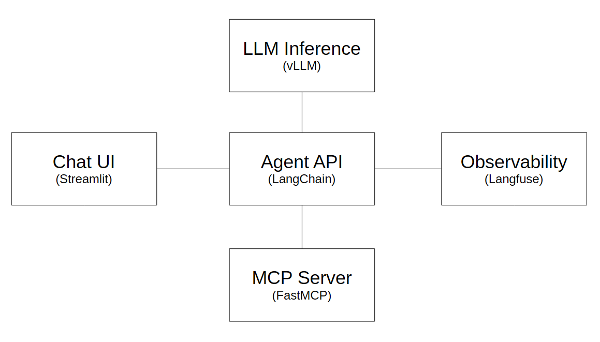
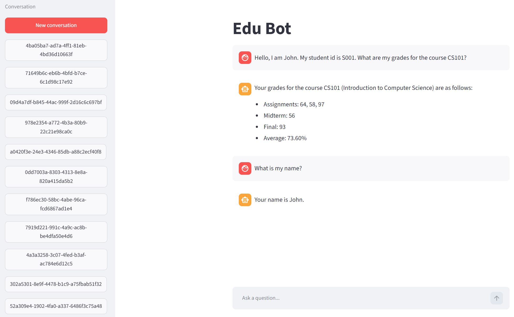
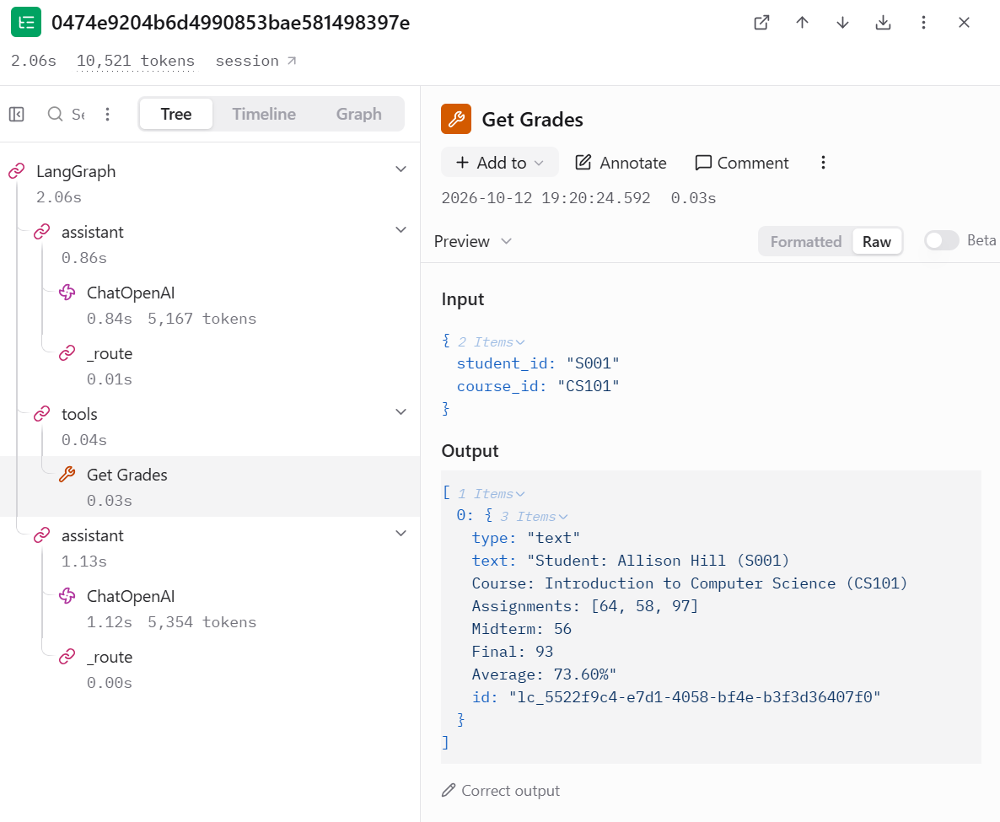

# Demo Project: Edu Bot
This repository contains a technical demonstration of an educational bot based on LLM technology with access to tools such as searching fetching Wikipedia articles, mathematics and unit conversion. 

For the architecture of the Edu Bot please refer to the figure below. The components are described in the Components section.

## Example
Subsequent images show that the Edu Bot succuessfully calls the tool which provides information about the student's grades. Furthermore, one can see that the Edo Bot has access to all information in a given thread. The second image shows a screenshot from Langfuse and demonstrates that every action is monitored. In particular, one can see the details of the tool call, including the input and output.

## Running the Project locally
- Run vLLM: See ./llm_inference/cmd.shell
- Run MCP server: cd ./mcp_server & python .\mcp_server
- Run Agent API: cd agent_api & uvicorn api:app --host 127.0.0.1 --port 1111
--> Make sure to set the LANGFUSE_SECRET_KEY, LANGFUSE_PUBLIC_KEY, and LANGFUSE_BASE_URL environment variables before running above command.
- Run streamlit: streamlit run app.py
- Run observability: cd observability & docker-compose up -d docker-compose.yml    

## Components
This section briefly describes the components of Edu Bot.

### MCP Server
The MCP server is implemented in `mcp_server/mcp_server` and exposes tool capabilities to the agent over the Model Context Protocol. It runs as a FastMCP service and provides tools for mathematical evaluation, unit conversion, Wikipedia search and article retrieval, and synthetic student grade lookups. These tools allow the agent to do facts, calculations, and domain-specific retrieval instead of relying only on model memory.

### LLM Inference
The project uses a self-hosted OpenAI-compatible inference endpoint (for example `Qwen/Qwen3-4B-Instruct-2507` using vLLM.

### Agent API
The agent API is a FastAPI service in `agent_api/api.py`. It creates conversation threads, stores and loads chat history with a SQLite-backed LangGraph checkpoint store, and exposes endpoints such as `/health`, `/conversations`, and `/conversations/{conversation_id}/messages`. The actual orchestration logic lives in `agent_api/agent_service.py`, where the LangGraph agent composes the model with MCP tools and manages tool execution and conversation state.

### Chat UI
The user-facing interface is a Streamlit app in `chat_ui/app.py`. It creates conversations, lists prior threads, restores message history from the agent API, sends user prompts, and displays assistant replies in a chat-style interface. It acts as the browser-based front end for the Edu Bot experience.

### Observability
Observability is configured in `observability/docker-compose.yml` and uses Langfuse. This stack captures agent runs so that one can monitor LLM calls, tool usage, and conversation performance during development.
